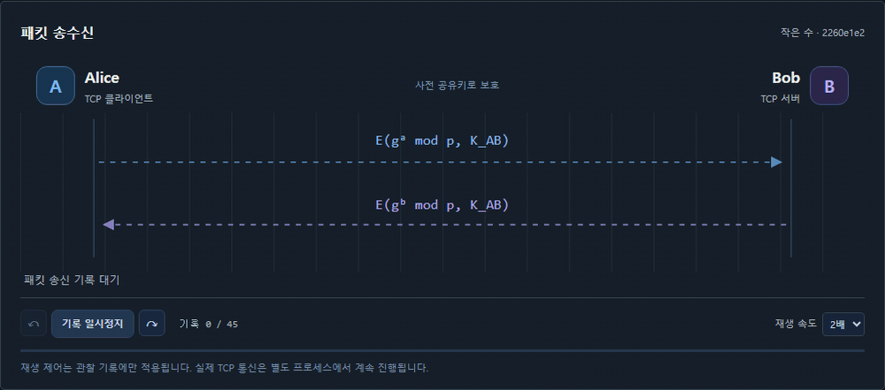
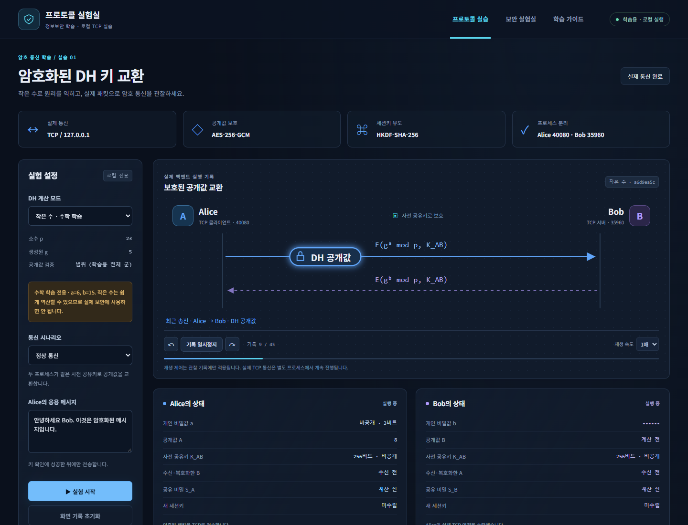
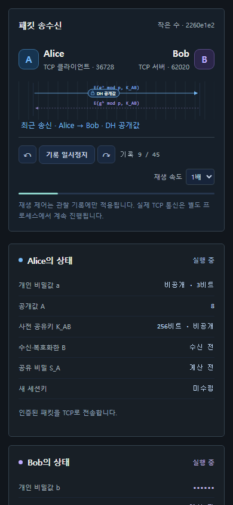

# Crypto DH Lab — A visual guide to encrypted communication

[Download for Windows · v0.1.1](https://github.com/leekmny/crypto-dh-lab/releases/tag/v0.1.1) · [Follow the exercises](docs/LEARNING.md) · [MIT License](LICENSE)

[한국어](README.md) | **English**

**How do Alice and Bob arrive at the same secret without sending their private values?**

Crypto DH Lab is a Korean-language learning lab where you can work through Diffie–Hellman with small numbers and inspect encrypted public values and real packets. The interface brings calculations, packets, and step-by-step explanations together.

Alice and Bob perform cryptographic operations in **separate Python processes** and communicate over **TCP on 127.0.0.1**. The web interface replays a record of the actual run. Pausing playback leaves the backend experiment running.

## Packet replay preview



This replay shows a normal small-number experiment at **1× speed**. Blue means **Alice → Bob** and purple means **Bob → Alice**. Moving packets are labeled **DH public value**, **key confirmation**, or **application message**. If your system has reduced motion enabled, the interface shows packet direction and type without animation.

<details>
<summary>Screenshots during packet transit · Desktop and mobile</summary>





</details>

## What will I learn?

- The roles of private exponents, public values, and the shared secret in DH.
- How the pre-shared key that protects the public values differs from the new session key derived from DH.
- How AES-GCM encryption and authentication, HKDF key derivation, and HMAC mutual key confirmation fit together.
- Where communication stops when the lab detects packet tampering or a key mismatch.

The recommended order is **calculate with small numbers → compare with Group 14 → observe tampering**. The [learning guide](docs/LEARNING.md) explains what values to watch in each exercise and provides questions to consider.

## Get started on Windows

1. Download `CryptoDHLab-Windows-x64.zip` from [v0.1.1 Releases](https://github.com/leekmny/crypto-dh-lab/releases/tag/v0.1.1).
2. **Extract the entire folder** from the ZIP.
3. Double-click `CryptoDHLab.exe` in the extracted folder. A small launcher window and your default browser will open.
4. In the browser, choose a calculation mode and scenario, then click **실험 시작** (Start experiment).

The release ZIP includes Python and the required libraries. Once set up, the exercises run without an internet connection or API key. Keep `CryptoDHLab.exe` and its `_internal` folder together so the application can run.

To quit, click **종료** (Exit) in the launcher or close that window. Closing the browser tab alone leaves the server running. Running the EXE again opens the existing lab interface. If the default port is in use, the app picks a free local port.

This build targets Windows x64 and is unsigned. Windows may display a prompt to verify the source. Run data is stored in `%LOCALAPPDATA%\CryptoDHLab`.

## Run or modify the source

With **Python 3.11 or newer** and Windows PowerShell, run the following command from the project root. Installing dependencies for the first time requires an internet connection.

```powershell
powershell -NoProfile -ExecutionPolicy Bypass -File .\run.ps1
```

The script sets up `.venv` and its dependencies, then opens the browser and runs the normal experiment. The default address is `http://127.0.0.1:8765`. Press `Ctrl+C` in the PowerShell window to quit. Append `-Mode small` to start with small numbers.

You can also set up the dependencies manually using these commands. First, check that `python` points to Python 3.11 or newer.

```powershell
python -m venv .venv
.\.venv\Scripts\python.exe -m pip install -r requirements-lock.txt
.\.venv\Scripts\python.exe scripts/generate_keys.py
.\.venv\Scripts\python.exe main.py --mode small --open --auto-run
```

`requirements-lock.txt` pins the versions used for verification on Windows with Python 3.14. On other supported environments, you can install from `requirements.txt`.

**Source downloads and clones do not include the EXE.** Download the executable from Releases or build it using the [Windows build and release guide](docs/RELEASING.md).

## Verify the results

Click **전체 검증 실행** (Run all checks) in the browser or run the following command to check real cryptographic operations, separate processes, and TCP communication. Results include the time the checks ran.

```powershell
powershell -NoProfile -ExecutionPolicy Bypass -File .\test.ps1
```

See the [public verification summary](docs/VERIFICATION.md) for the release checks and their scope.

## Project scope

This protocol model is for classroom and self-directed learning. It does not implement standard EKE, PAKE, or an audited production authenticated key exchange, and it has no formal security proof or professional security audit. Small-number mode uses a fixed example to illustrate the calculations.

Communication is limited to `127.0.0.1` on the same PC. The lab records decrypted application messages for learning purposes, so avoid entering real secrets or personal information. Keep the lab off public internet servers and out of production cryptographic communication.

The project source and documentation are available under the [MIT License](LICENSE). Bundled third-party components have their own licenses, listed in [THIRD_PARTY_NOTICES.txt](THIRD_PARTY_NOTICES.txt).

## Explore further

- [Three-step learning guide](docs/LEARNING.md)
- [Protocol, packet, and CLI reference](docs/REFERENCE.md)
- [Verification records and checked environments](docs/VERIFICATION.md)
- [Windows build and release preparation](docs/RELEASING.md)
