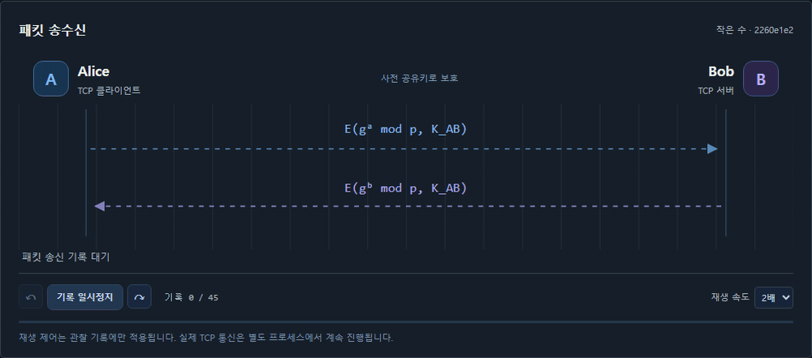
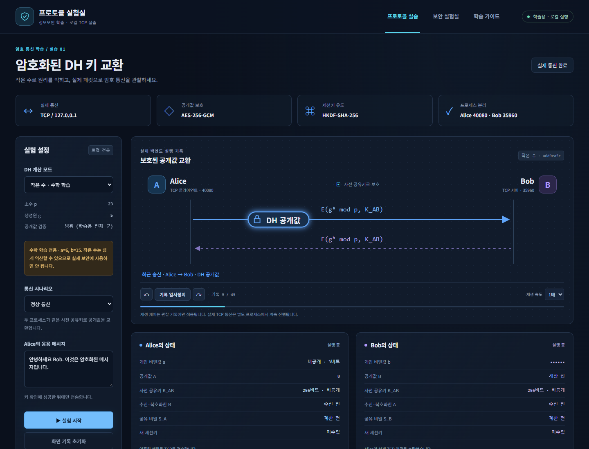
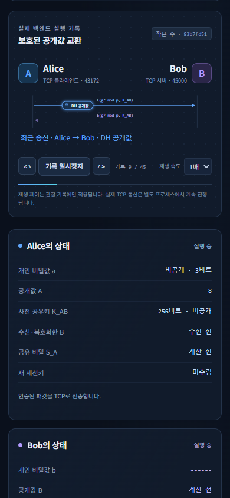

# Crypto DH Lab — 눈으로 배우는 암호 통신

[Windows 다운로드 · v0.1.1](https://github.com/leekmny/crypto-dh-lab/releases/tag/v0.1.1) · [따라 하기](docs/LEARNING.md) · [MIT License](LICENSE)

**Alice와 Bob은 비밀값을 보내지 않고 어떻게 같은 비밀을 만들까요?**

작은 수로 Diffie–Hellman의 계산을 따라가고, 암호화된 공개값과 실제 패킷을 살펴보는 한국어 학습 실험실입니다. 계산값, 패킷, 단계별 해설을 한 화면에서 연결해 볼 수 있습니다.

Alice와 Bob은 **서로 다른 Python 프로세스**에서 암호 연산을 수행하고, **127.0.0.1 TCP**로 통신합니다. 웹 화면은 실제 실행 기록을 재생합니다. 재생을 멈춰도 백엔드의 실험은 계속 진행됩니다.

## 패킷 재생 미리 보기



작은 수 모드의 정상 실험을 **1배속**으로 재생한 화면입니다. 파란색은 **Alice → Bob**, 보라색은 **Bob → Alice**입니다. 이동하는 패킷에 **DH 공개값**, **키 확인**, **응용 메시지**가 표시됩니다. 시스템에서 모션 줄이기를 켜면 방향과 종류가 정지 상태로 표시됩니다.

<details>
<summary>이동 중 화면 캡처 · 데스크톱과 모바일</summary>





</details>

## 무엇을 배우나요?

- DH의 개인 지수, 공개값, 공유 비밀이 각각 어떤 역할을 하는지
- 공개값을 보호하는 사전 공유키와 DH에서 유도한 새 세션키가 어떻게 다른지
- AES-GCM의 암호화·인증, HKDF의 키 유도, HMAC의 상호 키 확인이 이어지는 과정
- 패킷 변조나 키 불일치를 감지했을 때 통신이 어디서 멈추는지

권장 순서는 **작은 수로 계산 → Group 14로 비교 → 변조를 관찰**입니다. [학습 가이드](docs/LEARNING.md)에 각 실습에서 볼 값과 생각해 볼 질문을 정리했습니다.

## Windows에서 바로 시작

1. [v0.1.1 Releases](https://github.com/leekmny/crypto-dh-lab/releases/tag/v0.1.1)에서 `CryptoDHLab-Windows-x64.zip`을 받습니다.
2. ZIP의 **폴더 전체를 압축 해제**합니다.
3. 압축을 푼 폴더 안의 `CryptoDHLab.exe`를 더블클릭합니다. 작은 실행 창과 기본 브라우저가 열립니다.
4. 브라우저에서 계산 모드와 시나리오를 고른 뒤 **실험 시작**을 누릅니다.

배포 ZIP에는 Python과 필요한 라이브러리가 포함됩니다. 설치 후 실습에는 인터넷 연결이나 API 키가 필요하지 않습니다. `CryptoDHLab.exe`와 `_internal` 폴더를 함께 보관하세요. EXE만 옮기면 실행되지 않습니다.

종료할 때는 작은 실행 창의 **종료** 버튼을 누르거나 그 창을 닫습니다. 브라우저 탭만 닫으면 서버는 유지됩니다. 다시 EXE를 실행하면 기존 실습 화면을 엽니다. 기본 포트가 사용 중이면 빈 로컬 포트를 선택합니다.

Windows x64용이며 코드 서명은 없습니다. Windows에서 출처 확인 안내가 표시될 수 있습니다. 실행 데이터는 `%LOCALAPPDATA%\CryptoDHLab`에 저장합니다.

## 소스로 실행하거나 수정하기

**Python 3.11 이상**과 Windows PowerShell을 준비하고 프로젝트 루트에서 실행합니다. 최초 의존성 설치에는 인터넷 연결이 필요합니다.

```powershell
powershell -NoProfile -ExecutionPolicy Bypass -File .\run.ps1
```

스크립트가 `.venv`와 의존성을 준비하고 브라우저 및 실제 정상 실험을 시작합니다. 기본 주소는 `http://127.0.0.1:8765`이며, 종료는 해당 PowerShell 창에서 `Ctrl+C`입니다. 작은 수로 시작하려면 명령 끝에 `-Mode small`을 붙입니다.

의존성을 직접 준비하려면 다음 순서로 실행할 수도 있습니다. `python`이 Python 3.11 이상인지 먼저 확인하세요.

```powershell
python -m venv .venv
.\.venv\Scripts\python.exe -m pip install -r requirements-lock.txt
.\.venv\Scripts\python.exe scripts/generate_keys.py
.\.venv\Scripts\python.exe main.py --mode small --open --auto-run
```

`requirements-lock.txt`는 검증에 사용한 Windows·Python 3.14 환경의 고정 버전 목록입니다. 다른 지원 환경에서는 `requirements.txt`로 설치할 수 있습니다.

**소스를 내려받거나 clone해도 EXE는 포함되지 않습니다.** 실행 파일은 Releases에서 받거나 [Windows 빌드·배포 안내](docs/RELEASING.md)에 따라 직접 생성합니다.

## 실행 결과 확인

웹의 **전체 검증 실행**을 누르거나 다음 명령으로 실제 암호 연산과 독립 프로세스·TCP 통신 검사를 실행합니다. 검사 결과는 실행 시각과 함께 표시됩니다.

```powershell
powershell -NoProfile -ExecutionPolicy Bypass -File .\test.ps1
```

수행한 배포 검수와 범위는 [공개 검증 요약](docs/VERIFICATION.md)에 있습니다.

## 이 프로젝트의 범위

수업과 개인 학습을 위한 프로토콜 모델입니다. 표준 EKE·PAKE나 검증된 상용 인증 키 교환을 구현한 것이 아니며, 공식 보안 증명이나 전문 보안 감사를 제공하지 않습니다. 작은 수 모드는 계산을 이해하기 위한 고정 예제입니다.

통신은 같은 PC의 `127.0.0.1`로 제한됩니다. 복호화한 응용 메시지가 학습용 로그에 남으므로 실제 비밀이나 개인정보는 입력하지 마세요. 인터넷 공개 서버나 실서비스용 암호 통신으로 사용하지 마세요.

프로젝트 소스와 문서는 [MIT License](LICENSE)로 공개합니다. 포함된 외부 구성요소에는 각각의 라이선스가 적용되며, 고지는 [THIRD_PARTY_NOTICES.txt](THIRD_PARTY_NOTICES.txt)에 있습니다.

## 더 살펴보기

- [세 단계 학습 가이드](docs/LEARNING.md)
- [프로토콜·패킷·CLI 기술 참고](docs/REFERENCE.md)
- [검증 기록과 확인한 환경](docs/VERIFICATION.md)
- [Windows 빌드와 Release 준비](docs/RELEASING.md)
